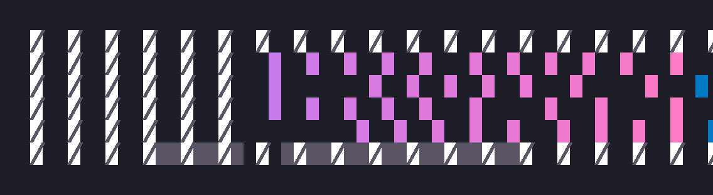

# HASSCrush

<p align="center">
  
</p>

HASSCrush puts [Charm Crush](https://github.com/charmbracelet/crush), a terminal AI coding agent, in your Home Assistant sidebar. It talks to your own models (Ollama Cloud, an Ollama server on your network, or any OpenAI-compatible service) and can use MCP tool servers such as a memory server.

This repository holds one add-on, in [`charm-crush/`](charm-crush/).

> The shape of this add-on (a web terminal behind HA ingress with a persistent tmux session) was inspired by [robsonfelix's claudecode add-on](https://github.com/robsonfelix/robsonfelix-hass-addons).

## What it does

- **Terminal in the sidebar.** Click **HASSCrush** in the sidebar. You get a shell with Crush ready to run. Home Assistant's own login protects it.
- **Your models.** Use Ollama Cloud, an Ollama server on your network, or a service such as OpenRouter or OpenAI.
- **Sessions survive.** Close the tab or lose the connection and your session is still there when you come back.
- **MCP servers (optional).** Connect memory, vision, search or other tool servers from one Options field.
- **Shared config (optional).** Several machines can read one Crush config from a URL.
- **Touch bar (optional).** On a phone or tablet, an on-screen row of keys (Ctrl, Alt, Tab, Esc, Del, Copy, Paste).
- **Home Assistant access.** The `ha` command is installed and Crush can call the Home Assistant API.
- **Crush updates (optional, off by default).** Crush can update itself when the add-on starts.

## What you need

- Home Assistant OS or a supervised install (anything that runs add-ons).
- One model source: an Ollama Cloud API key, an Ollama server you can reach, or an OpenAI-compatible API key.

## Install

1. In Home Assistant open **Settings → Add-ons → Add-on Store → ⋮ → Repositories**. Add `https://github.com/rainyvalley/HASCRUSH`.
2. Refresh the store and install **HASSCrush**.
3. Open the **Configuration** tab. Paste your key into **ollama_api_key**. For another service, set **provider** to `third_party` and fill in **third_party_base_url** and **third_party_api_key**.
4. Click **Start**, then click **HASSCrush** in the sidebar.

What happens next: the add-on log shows `[addon]` lines, then the terminal opens in the sidebar with Crush running. If Crush shows a "Choose a model" screen, no key was found; see [Troubleshooting](#troubleshooting).

## Options

Set these in the add-on's **Configuration** tab. Most changes apply when you restart the add-on.

### Model source

| Option | Default | What it does |
|---|---|---|
| `provider` | `ollama` | `ollama` for Ollama Cloud (and a LAN server). `third_party` for any OpenAI-compatible service. |
| `ollama_api_key` | empty | Your Ollama Cloud key. Hidden in the form. Wins over `ollama_key_url`. |
| `ollama_key_url` | empty | A URL that returns one line, `OLLAMA_API_KEY=...`. Used when `ollama_api_key` is empty. |
| `local_ollama_url` | empty | Your own Ollama server, for example `http://my-host:11434/v1`. Adds the `ollama-local` provider and a local vision model. |
| `third_party_base_url` | empty | With `third_party`: the service URL, for example `https://openrouter.ai/api/v1`. |
| `third_party_api_key` | empty | With `third_party`: its key. Hidden in the form. |
| `disti_token` | empty | A password sent as an `X-Disti-Token` header when fetching `ollama_key_url` or an MCP `token_url`, for config servers that need it. Hidden in the form. |

### Models

| Option | Default | What it does |
|---|---|---|
| `crush_large_model` | `ollama-cloud/deepseek-v4.1-flash` | The main model, from a list. |
| `crush_large_model_custom` | empty | Any model id. Wins over the list when set. |
| `crush_small_model` | `ollama-cloud/deepseek-v4.1-flash` | The helper model for titles and summaries, from a list. |
| `crush_small_model_custom` | empty | Any model id. Wins over the list when set. |
| `crush_deep_model` | `ollama-cloud/deepseek-v4.1-flash` | A model added to the picker for hard problems. Crush does not use it until you pick it. |
| `crush_deep_model_custom` | empty | Any model id. Wins over the list when set. |
| `crush_reasoning_effort` | `high` | How hard the main model thinks: `low`, `high` or `max`. Does not change the helper model. |
| `crush_discover_models` | `true` | Add every model your providers offer to the picker. Turn off to show only models listed in the config. |

A model id looks like `provider/model`, with letters, digits and `. _ : / @ + -` only.

### Servers and config

| Option | Default | What it does |
|---|---|---|
| `mcp_servers` | empty | MCP tool servers as one JSON array. See [MCP servers](#mcp-servers). |
| `crush_config_url` | empty | A URL of a shared Crush config, fetched at every start. See [Central config](#central-config). |

### Terminal

| Option | Default | What it does |
|---|---|---|
| `terminal_font_size` | `14` | Text size, 10 to 24. |
| `terminal_theme` | `dark` | `dark` or `light`. |
| `terminal_mouse` | `true` | `true`: the mouse wheel and clicks work inside Crush; select text with Shift+drag (Option+drag on a Mac). `false`: a plain drag selects text. |
| `touch_bar` | `true` | Show the key bar on touch devices. Desktop browsers do not get it. |
| `touch_bar_offset` | `0` | Lift the bar above the on-screen keyboard by this many pixels (-400 to 400). `0` picks -40 on iPhone and iPad, 0 elsewhere. |
| `touch_bar_debug` | `false` | Show a line of numbers above the bar. Turn on only if the bar sits in the wrong place. |
| `working_directory` | `/homeassistant` | Where Crush starts. Must be under `/homeassistant`, `/config`, `/share`, `/media`, `/ssl` or `/backup`, otherwise `/homeassistant` is used. This only picks the start folder. It does not stop Crush opening other paths. |
| `session_persistence` | `true` | Keep the session after you disconnect. |

### Updates

| Option | Default | What it does |
|---|---|---|
| `auto_update_crush` | `false` | At each start, if Crush has a newer release than the one built into the add-on, download it. The download is checked against a checksum file from the same release. If the check or the download fails, the built-in Crush is kept. |

## Providers

| You want | Set |
|---|---|
| Ollama Cloud | `provider` = `ollama`, `ollama_api_key` |
| Ollama Cloud and your own Ollama server | the above, plus `local_ollama_url` |
| OpenRouter | `provider` = `third_party`, `third_party_base_url` = `https://openrouter.ai/api/v1`, `third_party_api_key` |
| OpenAI | `provider` = `third_party`, `third_party_base_url` = `https://api.openai.com/v1`, `third_party_api_key` |
| Another OpenAI-compatible service | `provider` = `third_party`, its URL and key |

With `third_party` the add-on renames the provider to `openai-compat-3p`. The default model names (`deepseek-v4.1-flash` and so on) usually do not exist on your service. Set `crush_large_model_custom` and `crush_small_model_custom` to `openai-compat-3p/<model id as your service names it>`, for example `openai-compat-3p/meta-llama/llama-3.1-8b-instruct`.

Custom ids are used as given. They are not registered with prices or token limits. If Crush complains about a missing token limit, add a `model add` line as shown in [Models](#models). A plain `http://` base URL sends your key unencrypted; the log warns about it.

Your third-party key is not saved to disk by the add-on.

## Models

**Switching.** Press Ctrl+L in the terminal, or type `/` and choose *models*. The picker lists the models in your config, grouped by provider, plus the discovered ones.

**Refreshing.** The list is read when the add-on starts. Restart to see new models.

**Adding details** (price, context size, reasoning effort) goes in the Crush config file `/homeassistant/.crushdata/config/crush/crushrc`, or in your central config. Restart afterwards.

```bash
model add ollama-cloud/example-model --name "Example Model" --context-window 1048576 \
  --default-max-tokens 16000 --can-reason true --reasoning-effort high \
  --price-input 3.27 --price-output 16.33
model large ollama-cloud/example-model --reasoning-effort high
model small ollama-cloud/example-model --reasoning-effort high
```

## MCP servers

MCP servers give Crush extra tools. Put them all in the `mcp_servers` option as one JSON array, one entry per server. An entry replaces only the server with the same name. Other servers in a central config stay. Empty leaves the config as it is.

```json
[{"name":"memory","url":"http://mcp.example.lan:8300/mcp","token_url":"http://mcp.example.lan/memory-mcp.token"},
 {"name":"vision","url":"http://mcp.example.lan:3011/mcp","token":"sample-vision-token"},
 {"name":"search","url":"http://mcp.example.lan:3000/mcp"},
 {"name":"cad","command":"socat","args":["STDIO","TCP:mcp.example.lan:3010"],"token_url":"http://mcp.example.lan/cad-mcp.token","timeout":20}]
```

| Kind | Fields |
|---|---|
| Web server | `name`, `url`, and optionally `token` (pasted) or `token_url` (fetched at start). |
| Command (stdio) | `name`, `command`, `args` (a list; each item is one argument, spaces allowed, empty items are not), optional `timeout` in seconds. |
| Command with a token | A command entry with `token` or `token_url`. The token is sent as the first line on the command's input. Use it for a relay such as `socat` to a bridge that wants a token first. |

- A name may use letters, digits, `_` and `-`.
- If a token URL returns nothing, the server is added without a token and the log says so.
- An entry with invalid JSON, a bad name, a bad URL or a bad argument is skipped with a warning. The other entries still apply, and the skipped server's existing line in the config is left as it was.
- A token pasted in `mcp_servers` is visible in the Configuration tab. Prefer `token_url`.

Tokens are not written into the config file. The config refers to them as `$MCP_TOKEN_<name>`, with `-` in the name turned into `_`. Two names that give the same variable (`a-b` and `a_b`) clash, and the later one with a token is skipped.

For a memory server, use the same `user_id` in every client that should share one memory.

## Central config

`crush_config_url` is the address of a Crush config file that several machines can share. It is fetched at every start. Keep keys out of it; it reads them from the environment.

The add-on uses the fetched file only if all of these hold:

- The URL is `http://` or `https://` with plain URL characters. Prefer `https://`. With `http://` the log warns you.
- The file is 1 MB or less, looks like a Crush config (it has `provider add` or `model add` style lines) and passes `bash -n` (it is a shell script).
- Otherwise the add-on keeps the config it already has and logs a warning.

**The fetched file runs as a script with full add-on rights.** Only point this at a server you control, and over `https://` if you can. The add-on does not check who wrote the file.

If the file has a line `# config-version: N` and the same folder serves `config.version`, the log says whether you are current or stale.

## Environment variables and the env file

You can set options from the environment instead of the Configuration tab. The order of precedence is: real container environment, then the env file, then the Options tab.

| Variable | Same as option |
|---|---|
| `OLLAMA_API_KEY` | `ollama_api_key` |
| `OLLAMA_KEY_URL` | `ollama_key_url` |
| `LOCAL_OLLAMA_URL` | `local_ollama_url` |
| `THIRD_PARTY_BASE_URL`, `THIRD_PARTY_API_KEY` | `third_party_base_url`, `third_party_api_key` |
| `DISTI_TOKEN` | `disti_token` |
| `CRUSH_LARGE_MODEL`, `CRUSH_SMALL_MODEL`, `CRUSH_DEEP_MODEL` | the three model options |
| `CRUSH_REASONING_EFFORT` | `crush_reasoning_effort` |
| `CRUSH_DISCOVER_MODELS` | `crush_discover_models` (`false` turns it off) |
| `CRUSH_CONFIG_URL` | `crush_config_url` |
| `MCP_SERVERS` | `mcp_servers` |

The **env file** is `/homeassistant/.crushdata/env`, one `NAME=value` per line. It is read at every start.

- Only the names in the table above are read, plus `MCP_TOKEN_*`, `THIRD_PARTY_*` and any other `CRUSH_*`. Other names (for example `PATH` or `LD_PRELOAD`) are skipped and logged by name.
- A value may use letters, digits and `_ . / : @ + % = , ~ ?`. Wrap a value with spaces in double quotes. For JSON such as `MCP_SERVERS`, wrap it in single quotes and leave out any `'` inside it.
- Anything else is skipped and logged without showing the value. Nothing from this file is run as a command.

## Home Assistant access

`HA_URL` and `HA_TOKEN` are set for you, and the `ha` command uses them. Ask Crush, or run:

```bash
ha core logs 2>&1 | tail -50
ha core stats
curl -s -H "Authorization: Bearer $HA_TOKEN" "$HA_URL/api/states/light.kitchen" | jq '.state'
```

`HA_URL` is `http://supervisor/core`, which only works inside add-ons. Long-lived tokens from your profile page do not work there.

The add-on has the Supervisor **manager** role. Some calls are refused on purpose:

| Call | You see | Why |
|---|---|---|
| `/hassio/...` or `/api/hassio/...` | 403 | Blocked for every add-on. |
| `supervisor.*` or `hassio.*` WebSocket commands | `unauthorized` | Blocked. Use the `ha` command or REST. |
| Admin-only endpoints | 403 | Needs the admin role, which this add-on does not have. |
| Docker socket | not available | The add-on has no Docker access. (The `docker` command is installed but cannot connect.) |

At each start the log prints OK or `DENIED <code>` for the Supervisor and Core checks. A starter `CRUSH.md` is written once to `/homeassistant/.crushdata/` with these limits so Crush stops retrying refused calls. Your edits to it are kept.

## Where files are kept

| Path | What it is |
|---|---|
| `/homeassistant/.crushdata/config/crush/crushrc` | The Crush config. |
| `/homeassistant/.crushdata/config/crush/ollama.env` | The saved Ollama key. |
| `/homeassistant/.crushdata/CRUSH.md` | Standing instructions for the agent. |
| `/homeassistant/.crushdata/data/` | Crush session data. |
| `/homeassistant/.crushdata/env` | Optional env file. |
| `/homeassistant/.crushdata/tmux.conf` | Your own tmux settings, loaded last. |

These are in your Home Assistant config folder, so they are in HA backups.

## Security notes

- The terminal is a live root shell inside the add-on. It is reachable only through Home Assistant's ingress, so your HA login is the lock. It listens on loopback behind a small gate that accepts only the ingress proxy.
- **Crush holds a manager-level Home Assistant token and any MCP tokens in its environment.** Anything Crush runs can read them. Treat prompts, web pages and files you give it as able to ask for them.
- The add-on can read and write your whole HA config folder, and read `/ssl` and `/backup`. That includes secrets and backups.
- **Other add-ons that can write your HA config folder can change `/homeassistant/.crushdata/`** (the Crush config, `env` and `tmux.conf`), and that code runs as root here. Only install add-ons you trust that have this access.
- Keys are saved under `/homeassistant/.crushdata/`, so they are in HA backups. Protect backups and rotate a key if one leaks.
- Keys and the `disti_token` are hidden in the Configuration form. `mcp_servers` is not, so use `token_url` there.
- Log lines show a URL without any `user:password@` part or `?query`.
- The add-on has a custom AppArmor profile, no `full_access`, no Docker API and no host networking. Toggling **Protection mode** for this one add-on is the way out if a task needs more reach.
- ttyd, Crush and the `ha` command are pinned versions checked by sha256 when the image is built.

## Copy and paste

Tmux and Crush both take the mouse, so a plain drag does not select text in the browser.

- **Select with a modifier.** Hold **Shift** (Option on a Mac) while dragging. The selection is copied when you let go. Or set `terminal_mouse` to `false`.
- **Copy from Crush or tmux.** Text copied inside Crush, or in tmux copy mode (scroll with the wheel; `Enter` or `y` copies), goes to your browser clipboard. Any program that prints the right escape sequence to the terminal can do this too, so text you `cat` from an untrusted file can replace your clipboard. If the browser refuses (plain `http://`, or no permission), a "Copy" notice appears; one tap copies.
- **Touch bar Copy.** Copies the selection. With nothing selected it opens a box with the visible screen to copy from.
- **Paste.** Ctrl+V or Cmd+V, or the bar's **Paste**. Over plain `http://` the bar opens a paste box instead (long-press, Paste, Send).
- **Older output** is in tmux, not the browser. Scroll with the wheel to enter copy mode.

The copy helpers load even when `touch_bar` is off. Silent copying needs the page to be on HTTPS or `localhost`.

## Troubleshooting

| You see | It means | Do this |
|---|---|---|
| "Choose a model" screen at first launch | No config or key was found. | Check the log for `[addon]` lines. Set `ollama_api_key`, or check `crush_config_url`. |
| `Unauthorized` in Crush | The key is wrong or old. | Set `ollama_api_key` and restart. |
| `local_ollama_url` set, but no local models | The URL was rejected or the server is unreachable. | Look for `local_ollama_url failed charset validation` in the log. Use `http://host:11434/v1`. |
| A model is missing from the picker | Discovery is off or the list is old. | Turn on `crush_discover_models` and restart. For prices or limits, add a `model add` line. |
| Log says `has lines that were SKIPPED` | The env file has a line the add-on will not read. | Check the name against [the list](#environment-variables-and-the-env-file) and the value rules. |
| Log says `mcp_servers ... skipped` | That entry has a bad name, URL, argument or timeout. | Fix the entry named in the log. |
| A `401` from an MCP tool | That entry's token is wrong. | Fix the token or `token_url`. |
| `ha` fails | The token or API is not reachable. | Run `curl -s $HA_URL/api/ -H "Authorization: Bearer $HA_TOKEN"`. |
| Supervisor `401` or `403` | Some refusals are expected (see the table above). | If the start-up check says `token DENIED` or `SUPERVISOR_TOKEN missing`, update or reinstall the add-on. |
| Cannot copy text | The mouse belongs to Crush. | Hold Shift (Option on a Mac) while dragging. See [Copy and paste](#copy-and-paste). |
| Slow answers | The add-on does not run models. | Check your Ollama host or provider. |

## Changelog

Release notes are in the add-on's **Changelog** tab (`charm-crush/CHANGELOG.md` in the repo).

## A note on AI assistance

Parts of this project — code, configuration, and documentation — were written with the help of generative AI. Everything in here was reviewed, tested, and corrected by a human before being committed; nothing was accepted on the model's say-so.

## License

MIT — see [LICENSE](LICENSE).
